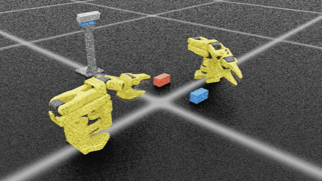

# SO-ARM101 双腕ハンドオーバー

## 概要



2 台の SO-ARM101 を向かい合わせに置き、3 × 3 × 6 cm の青と赤のブロックを片方の腕からもう片方の腕へ受け渡して、横から見て T の字（青を立て、その上に赤を横向きに載せる）を組み立てる。シミュレータは Isaac Sim 5.1 と Isaac Lab v2.3.2。

| 置いているもの | 役割 |
|---|---|
| 供給側の腕（Feeder） | 台に置いた青と赤を掴み、組立側に差し出す |
| 組立側の腕（Builder） | 差し出されたブロックを受け取り、T 字の位置に置く |
| 青と赤のブロック | 供給側の台に置く。強化学習版は置く位置と向きを毎回ずらす（位置 ±2 cm、向き ±25 度）。IK 版も `--randomize` で同じようにずらせる |
| D435i（マウントで机に固定） | 2 台の横から、台のブロック、受け渡し、T 字を撮る |

### T 字の組み立ての流れ

1. 認識：D435i の画像から OWLv2 で青と赤を見つけ、深度から位置と向きを推定する
2. 青を渡す：供給側が青を掴み、縦にして低い位置に差し出す。組立側が上端を真上からつまんで受け取る
3. 青を置く：組立側が青を T 字の位置に立てる
4. 赤を渡す：供給側が赤を掴み、縦にして差し出す。組立側が上端を横から掴んで受け取る
5. 赤を置く：組立側が手首を倒して赤を横向きにし、立てた青の上に載せる

### 2 通りの動かし方

同じ流れを、IK だけで動かす版と、受け渡しを強化学習の方策で動かす版の 2 通りで作った。

| 流れ | IK 版（`scripts/build_t_ik.py`） | 強化学習版（`scripts/demo_t.py`） |
|---|---|---|
| 1. 認識 | OWLv2 と深度 | 同じ |
| 2・4. 掴んで差し出す（供給側） | IK | 方策 `pick_low`（青）、`pick`（赤） |
| 2・4. 受け取る（組立側） | IK | 方策 `handover_top`（青）、`handover`（赤） |
| 3・5. 置く（組立側） | IK | 運動学で計算した決まった軌道（学習は今後の課題） |

強化学習版の方策は、Isaac Lab と RSL-RL の PPO で、工程ごとに別々に学習した。関節の目標は「運動学で計算した参照の動き + 方策の補正」で、方策は補正（行動 × 0.15 rad）だけを出す。参照の動きはブロックの位置から計算するが、指令の遅れと腕のたわみで手先がずれる。そのずれを補正で埋める。爪の開閉は方策を使わず、決まりで行う。

どちらの版も、掴んだブロックは手先に固定する形で把持を簡略化している（爪とブロックの接触による把持は扱っていない）。ブロックは衝突のない見た目だけの物体にしている。

## 結果

条件はどれもシミュレーション上で、アクチュエータは指令の遅れと腕のたわみを含む設定 `real`（概算値）。

### T 字の組み立て（流れの 1〜5 を通して実行）

IK 版は 1 回の実行の値。強化学習版は、ブロックの置き方を変えた 8 回（乱数の種 0〜7、`--seed`）の値。

| | IK 版 | 強化学習版 |
|---|---|---|
| T 字 | 完成 | 8 回中 8 回で完成 |
| 動き始めから完成までの時間 | 52.5 秒（各動作の時間を半分にする設定 `--speed 2.0`） | 21.6〜21.7 秒（等速） |
| 置いた位置の誤差（ブロックの中心と目標の差） | 青 1.6 mm、赤 1.9 mm（完成したとき） | 青 4.8 mm、赤 3.8 mm（組立側が離す直前、8 回とも同じ値） |
| 認識の誤差（流れの 1 で推定した位置と向きと、シミュレータの正解との差） | 青 0.3 mm・0.3 度、赤 0.1 mm・0.3 度 | 位置 0.2〜0.6 mm、向き 0.0〜1.4 度 |

強化学習版の置いた位置の誤差が 8 回とも同じなのは、受け取ったあとのブロックを爪の間の決まった位置に固定し、置く動作を決まった軌道で動かしているためと考えられる。置き方の違いが効くのは、掴んで受け渡すまでの部分だけになる。

### 受け取る方策の効果（強化学習版の、組立側が受け取る工程だけ）

受け取る方策の学習に使った環境（渡す側がブロックを差し出した状態から始まり、差し出す姿勢は関節ごとにランダムにずらす）で、方策を使った場合と、補正を 0 にして参照の動きだけで動かした場合を比べた（`scripts/play.py`、各 512 エピソード）。数値は、組立側が爪でブロックを挟み、受け渡しが成立したエピソードの割合。

| 方策 | 補正 0（参照の動きだけ） | 方策あり |
|---|---|---|
| `handover`（赤、上端を横から掴む） | 19.5 % | 97.9 % |
| `handover_top`（青、上端を真上からつまむ） | 10.9 % | 37.3 % |

参照の動きだけでは、指令の遅れと腕のたわみで手先がずれ、爪の間にブロックが入らない。方策の補正でそのずれを埋めている。`handover_top` は学習が 150 回と短く、37.3 % にとどまる。

### 通しの受け渡し（強化学習版の、掴む → 差し出す → 受け取る）

供給側が台のブロックを掴んで差し出し、組立側が受け取って手前へ引き寄せるまでを、64 個の環境で同時に動かした（`scripts/demo_relay.py`、方策は `pick` と `handover`）。64 環境すべてで成功した。

### 使った方策のチェックポイント

学習した 4 つの方策のチェックポイントは `checkpoints/` に入れている。結果はこのチェックポイントで出した。学習の回数は PPO の更新の回数。

| 方策 | 動作 | 学習の回数 | 使ったチェックポイント |
|---|---|---|---|
| `pick_low` | 供給側が青を掴み、低い位置に差し出す | 150 回 | `checkpoints/pick_low_model_149.pt` |
| `pick` | 供給側が赤を掴み、縦にして差し出す | 1000 回 | `checkpoints/pick_model_100.pt`（780 回目以降に成績が崩れたため、早い方を使用） |
| `handover_top` | 組立側が青の上端を真上からつまむ | 150 回 | `checkpoints/handover_top_model_149.pt` |
| `handover` | 組立側が赤の上端を横から掴む | 300 回 | `checkpoints/handover_model_100.pt` |

`demo_t.py` と `demo_relay.py` は、チェックポイントを指定しないと、`logs/` にあるいちばん新しい学習の最後のチェックポイントを使う。`checkpoints/` の方策で動かすときは、次のように指定する。

```bash
python scripts/demo_t.py --perception \
  --pick_low checkpoints/pick_low_model_149.pt --pick checkpoints/pick_model_100.pt \
  --handover_top checkpoints/handover_top_model_149.pt --handover checkpoints/handover_model_100.pt
python scripts/demo_relay.py --pick_checkpoint checkpoints/pick_model_100.pt \
  --handover_checkpoint checkpoints/handover_model_100.pt
```

## 動作環境

| 項目 | 版 |
|---|---|
| OS | Ubuntu 22.04 |
| GPU | RTX 4080（16 GB） |
| Isaac Sim | 5.1.0 |
| Isaac Lab | v2.3.2 |
| 強化学習 | RSL-RL（PPO） |

## ディレクトリ構成

```
so101_dual_handover/
├── so101_handover/
│   ├── __init__.py            # 環境の登録
│   ├── robot_cfg.py           # SO-101 の設定
│   ├── handover_env_cfg.py    # 環境の設定（配置、判定、報酬の重み）
│   ├── handover_env.py        # 環境の本体（観測、報酬、終了判定、リセット）
│   ├── pick_env_cfg.py        # 供給側の学習の環境の設定（置いたブロックを掴んで差し出す）
│   ├── pick_env.py            # 供給側の学習の環境の本体
│   ├── tasks.py               # train.py と play.py の --task で選ぶ環境の一覧
│   ├── t_task_cfg.py          # T 字タスクのシーンと配置
│   ├── ik.py                  # DLS による IK
│   ├── arm_kinematics.py      # 全環境まとめての順運動学と DLS（受け取る側の参照の動き）
│   ├── gripper_points.py      # 爪の表面点（食い込みの判定）
│   ├── relay_env.py           # 掴む → 差し出す → 受け取る の通しの環境
│   ├── relay_t_env.py         # 受け渡しを方策で行い、青を立てて赤を載せる T 字の環境
│   ├── perception.py          # D435i の画像と深度からブロックの位置と向きを推定
│   └── agents/
│       └── rsl_rl_ppo_cfg.py  # PPO の設定
├── checkpoints/               # 学習した 4 つの方策（結果で使ったもの）
├── docs/
│   └── setup_env.md           # conda 環境の作り方
├── models/
│   └── d435i_mount/           # 横に置く D435i のマウント（USD）とカメラの座標
└── scripts/
    ├── check_scene.py         # シーンの確認
    ├── build_t_ik.py          # IK で T 字を組み立てる
    ├── train.py               # 学習
    ├── play.py                # 再生と動画の保存
    ├── demo_relay.py          # 掴む → 差し出す → 受け取る の通しの再生
    └── demo_t.py              # 方策で受け渡して立てた T 字を組み立てる
```

## セットアップ

専用の conda 環境 `env_pai_handover` を新しく作る。手順は [docs/setup_env.md](docs/setup_env.md) を参照。

- Isaac Sim 5.1.0、Isaac Lab v2.3.2、RSL-RL を入れる
- このリポジトリは pip でインストールせず、activate 時に `PYTHONPATH` へ追加する
- SO-101 の URDF とメッシュは同梱していない。TheRobotStudio の SO-ARM100 リポジトリから取得して `assets/so101/` に置く

URDF を別の場所に置く場合は環境変数で指定する。

```bash
export SO101_URDF_PATH=/path/to/so101_new_calib.urdf
```

以降のコマンドはすべてリポジトリの直下で実行する。

```bash
conda activate env_pai_handover
cd $PAI_REPO
```

## 使い方

### T 字の組み立て（IK）

供給側（Feeder）が青と赤のブロック（3 × 3 × 6 cm）を順に掴んで組立側（Builder）に渡し、組立側が T 字に組み立てる。
`--shape` で形を選ぶ。`standing`（既定）は横から見て T（青を立て、その上に赤を横向きに載せる）、`flat` は上から見て T の形に置く。

```bash
python scripts/build_t_ik.py --hold
python scripts/build_t_ik.py --shape flat --hold
```

立てた T の流れ

| ブロック | 受け渡し | 置き方 |
|---|---|---|
| 青 | 供給側が縦にして下端を水平に持ち、低い位置で差し出す。組立側は真上から上端をつまむ | 縦のまま下ろして立てる |
| 赤 | 握手型（供給側が下端、組立側が上端を水平に持つ） | 組立側が手首を倒して平らにし、立てた青の上に横向きに置く |

- 両腕とも休息姿勢（腕をたたんだ姿勢）から始まる。供給側は渡し終えたら、組立側は置き終えたら休息姿勢に戻り、次の出番まで待つ
- 組立側は、供給側がブロックを差し出し始めると同時に休息姿勢から上がる（休息姿勢の手先が受け渡し位置に近いため）
- 供給側の休息姿勢は shoulder_pan を回し、手先を横に向けている（正面のままだと、横の D435i から見て青のブロックの手前に手先が来て隠すため）
- 置き終えた組立側は、真上に上がってから shoulder_pan を回して T 字の横から離れ、休息姿勢へ戻る（離れる動きと戻る動きは IK を使わず、関節角を直接動かす）
- 各工程で、腕どうしの接触と、腕と自分が持っていないブロックの接触を「干渉」として表示する
- 各工程の名前と、指令と実際の TCP の誤差が表示される
- 最後に位置の誤差、青の立ち具合、赤の水平度などを表示する
- `--speed 2.0` で各動作の時間が半分になる。最後に全体の所要時間（シミュレーション上）を表示する
- 掴む・置く直前の工程だけ TCP 誤差が 4 mm 以下になるまで待ち、それ以外の工程は 15 mm で次へ進む
- `--actuator` でアクチュエータの設定を切り替える（下の表）
- 配置や把持の設定は `so101_handover/t_task_cfg.py` で変更する

アクチュエータの設定（`so101_handover/robot_cfg.py`）

| 設定 | 内容 |
|---|---|
| `ideal`（既定） | 暗黙的な PD 制御。硬く、よく減衰し、遅れがない |
| `mjcf` | 公式の MuJoCo モデル（TheRobotStudio/SO-ARM100 の `so101_new_calib.xml`、Apache-2.0）の STS3215 の値を使った暗黙的な PD 制御 |
| `real` | 指令の遅れと腕のたわみを含む概算値を使った明示的な PD 制御（`DelayedPDActuatorCfg`）。指令の遅れで揺れないよう、IK は URDF から作った運動学モデル上で解き、重力によるたわみは手先の位置の誤差からゆっくり補正する |

#### 横の RealSense D435i

双腕の横に、机に固定するマウント（支柱 200 mm、俯角 25 度）に載せた RealSense D435i を置いている。
マウントと D435i の本体はいつもシーンに置き、ブロックの認識（`--perception`）と動画の撮影（`--side_camera`）に使う。

| 項目 | 値 |
|---|---|
| マウントの台座の位置 | 2 台の土台を結ぶ線の横。どちらの土台からも 0.4 m 以上離れる |
| 解像度 | 1280 × 720 |
| 深度を測れる距離 | 0.28 m 以上（これより近い深度は使わない） |
| 写る範囲 | 供給台の青と赤、受け渡し位置、立てた T。組立側の土台は画面の右外 |

- マウントの形状は `models/d435i_mount/d435i_desk_mount_side.usda`、カメラの座標と内部パラメータは同じフォルダの `frames_side_25deg_200mm.json`
- D435i の本体の箱は、前面をカラーカメラの光学中心の 1 mm 後ろにしている（カメラが箱の中に入らないようにするため）
- カメラ内の各フレームの位置は realsense-ros の `_d435.urdf.xacro` の公称値。深度はカラーと同じ位置・画角で近似している

#### カメラでブロックを認識して組み立てる

D435i の画像から、学習済みの物体検出モデル（OWLv2）で「a blue block」「a red block」を検出し、
深度から位置と向きを推定して掴む。シミュレータの正解の位置は掴む位置の計算に使わない。

```bash
python scripts/build_t_ik.py --perception --hold
python scripts/build_t_ik.py --perception --randomize --seed 3 --hold
```

- `--randomize` でブロックの初期位置（±2 cm）と向き（±25 deg）をランダムにする
- `--depth_noise` で深度に距離に比例したノイズ（標準偏差は距離の 0.5 %、仮の値）を加える
- 推定と正解の差（位置 mm、向き deg）を表示する
- 検出した枠と推定した中心・長手方向を描いた画像を `outputs/perception/` に保存する

認識の流れ

1. OWLv2 で、言葉に合うブロックの枠を RGB 画像から検出する
2. 枠の中の深度を点群に変換し、ブロックの上面の高さの点だけを残す。点の中央値から大きく離れた点（枠に写り込んだ奥の物）も捨てる
3. 主成分分析の主軸を長手方向とし、上面の点の範囲の中央を位置とする。斜め上から見ると手前の側面の上の端も写るので、点の平均ではなく範囲の中央を使う
4. 長手方向の見えている長さがブロックより短いときは、片側の端が腕などに隠れているとみなし、見えている端から長さの半分の位置を中心とする

#### 動画の撮影

`--side_camera` で、D435i のカラー画像を連番の JPEG で保存する。

```bash
python scripts/build_t_ik.py --perception --actuator real --speed 2.0 --side_camera
mkdir -p videos
ffmpeg -framerate 30 -i outputs/side_camera/%05d.jpg -c:v libx264 -pix_fmt yuv420p videos/side_camera.mp4
```

- 画像はシミュレーション上の 1 秒あたり `--side_fps` 枚（既定 30）保存する。`-framerate` を同じ値にすると、シミュレーション上の時間と同じ速さの動画になる
- `--check_ready --side_camera` で、休息姿勢のまま数枚だけ保存して画角を確認できる

把持は、グリッパを閉じる動作に合わせてブロックを手先に固定する方式で簡略化している（爪とブロックの接触による把持は扱っていない）。

### シーンの確認

最初に必ず実行し、ロボットの向きとブロックの持ち方を確認する。

```bash
python scripts/check_scene.py --num_envs 4
```

確認すること

- 2 台の腕が向かい合っているか（向きは `robot_cfg.py` の `yaw_deg`、間隔は `handover_env_cfg.py` の `base_distance`）
- ブロックが縦になって、渡す側のグリッパに下端を挟まれているか（`tcp_offset`、`block_in_tcp_quat`、`GIVER_PRESENT_POS` の `wrist_roll`）
- ブロックの中心が受け渡し位置の付近にあるか（`GIVER_PRESENT_POS`）

### 学習

`--task` で学習する環境を選ぶ。

| `--task` | 学習する動作 | ログの保存先 |
|---|---|---|
| `pick` | 供給側が、台に置いたブロックを真上から掴み、縦にして受け渡し位置に差し出す | `logs/rsl_rl/so101_pick_present/<日時>/` |
| `handover`（既定） | 組立側が、差し出されたブロックの上端を受け取り、手前へ引き寄せる | `logs/rsl_rl/so101_handover/<日時>/` |

```bash
python scripts/train.py --task pick --headless --num_envs 4096 --max_iterations 300
python scripts/train.py --task handover --headless --num_envs 4096 --max_iterations 300
```

供給側の学習（`--task pick`）の流れ

1. ブロックは青か赤の置き場所に、位置 ±2 cm、向き ±25 度でずらして置く。供給側は休息姿勢から始める
2. 関節目標は「参照の動き + 方策の補正」とし、方策は補正だけを学習する（`use_reference`）
   - 参照の動き: 休息姿勢 → 掴む位置の 5 cm 上（1.5 秒）→ 掴む姿勢（1.0 秒）。掴んだら → 差し出す姿勢（2.0 秒）。決めた関節角の間を補間した動き
   - 真上と掴む姿勢は、エピソードの始めにブロックの位置と向きから URDF の運動学で計算する（`adapt_reference`）。ブロックは衝突なしなので、補正が大きいと横から通り抜けて近づく動きを覚えてしまうため
   - 補正: 行動 × 0.15 rad（`residual_mode = "direct"`）。腕の重さによるたわみ、指令の遅れを補正する
   - 行動を積算して補正にする方式（`"integrate"`）では、学習中の手探りのノイズも積算され、ノイズのない再生では動きが変わった（差し出せた割合: 学習中 76〜85 %、再生 3.5 %、ノイズありの再生 35 %、補正 0 の再生 74 %）
3. 掴む位置が爪の間に入るとグリッパが閉じ、爪がブロックの幅まで閉じた状態が `grasp_steps` ステップ続いたら、ブロックを手先に固定する
   - ブロックは衝突なしの見た目だけの物体なので、爪の表面点（URDF のメッシュから抽出）がブロックの内側に入ったら「食い込み」とし、罰を与える。食い込んでいる間は掴んだと判定しない
   - グリッパは、閉じた爪がブロックに入らない位置のときだけ閉じる。TCP は閉じた爪の中心に置く
4. 手首を起こしてブロックを縦にし、掴んだ端を下にして、中心を受け渡し位置に置き、手先を組立側に向ける
5. この姿勢を `success_hold_steps` ステップ保ったら成功（エピソードは時間切れまで続ける）
6. 掴んだあとは、受け渡しまでグリッパを閉じたままにする
7. 掴んだブロックを作業範囲の外へ持っていったら、失敗としてエピソードを終える

参照の動きを使わずに（`use_reference = False`）、関節目標を行動で直接動かす学習も試した。
掴む動きは覚えたが、掴んだあとの動きが大きくばらつき、差し出す姿勢には届かなかった。

`Episode/` 以下の `ep_success`（差し出せた割合）、`ep_grasped`（掴めた割合）、`ep_drop`（落とした割合）、`grasp_dist`（掴む前の TCP と掴む位置の距離）、`penetration_rate`（掴む前に爪がブロックに食い込んでいるステップの割合）、`present_dist`（掴んだあとのブロックの中心と受け渡し位置の距離）を見る。

受け取る側の学習（`--task handover`）の流れ

1. 渡す側は差し出す姿勢（関節角にばらつきあり）でブロックを持つ。受け取る側は休息姿勢から始める
2. 関節目標は「参照の動き + 行動 × 0.15 rad」
   - 参照の動き: 休息姿勢 → 受け取る手前（掴む位置の 6 cm 手前、1.2 秒）→ 受け取る姿勢（0.8 秒）。受け取ったら → 引き寄せる姿勢（1.0 秒）
   - 各姿勢は、毎ステップ、ブロックの上端の位置と向きから URDF の運動学で更新する（減衰最小二乗法、`arm_kinematics.py`）。爪の幅の向きをブロックの長手方向に合わせる
3. 上端が爪の間に入るとグリッパが閉じ、閉じた状態が 3 ステップ続いたら受け渡し成立。渡す側が開き、ブロックは受け取る側の手先に固定される
4. ブロックを手前に引き寄せ、3 cm 以内で 30 ステップ保ったら成功

以下は、受け取る側の学習（`--task handover`）の説明。ログは `logs/rsl_rl/so101_handover/<日時>/` に保存される。TensorBoard で確認する。

```bash
tensorboard --logdir logs/rsl_rl/so101_handover
```

`Episode/` 以下を見る。

| 項目 | 内容 |
|---|---|
| `ep_success` | 直近 1024 エピソードのうち成功した割合 |
| `ep_released` | 直近 1024 エピソードのうち受け渡しが成立した割合 |
| `ep_drop` | 直近 1024 エピソードのうちブロックを落とした割合 |
| `ep_drop_before_release` | そのうち、受け渡しの前にブロックが落ちた割合 |
| `ep_length` | 直近 1024 エピソードの平均の長さ（ステップ数。最大 240） |
| `reach_dist` | 受け取る側の TCP と把持点の距離の平均 [m] |

まず 300 回ほど学習して `ep_released` と `ep_success` が上がり始めるかを確認し、上がっていれば `--resume` で続きを学習する。

### 通しの再生（掴む → 差し出す → 受け取る）

```bash
python scripts/demo_relay.py --pick_checkpoint <供給側の model_*.pt> --handover_checkpoint <受け取る側の model_*.pt>
python scripts/demo_relay.py --pick_checkpoint <...> --handover_checkpoint <...> --video --headless
```

- 供給側の方策で台のブロックを掴んで差し出し、差し出す姿勢を 10 ステップ保ったら（または掴んでから 3 秒たったら）、受け取る側の方策が動き始める
- 受け取る側が上端を掴んだら、供給側は手を開いて休息姿勢へ戻り、受け取る側は手前へ引き寄せる
- 環境は `so101_handover/relay_env.py`（供給側の環境に受け取る側の参照の動きと判定を追加したもの）
- 動画は `outputs/relay_video/` に保存される

### 立てた T 字の組み立て（強化学習の方策で受け渡し）

青は立てるため、低い位置で受け渡し、組立側が上端を真上からつまむ（IK 版と同じ受け渡し方）。赤は高い位置で上端を横から掴み、手首を倒して青の上に載せる。

| `--task` | 内容 | ログの保存先 |
|---|---|---|
| `pick_low` | 青を掴み、持ち上げてから低い位置に差し出す | `logs/rsl_rl/so101_pick_low/` |
| `handover_top` | 低い位置の青の上端を真上からつまみ、立てる位置の上へ運ぶ | `logs/rsl_rl/so101_handover_top/` |

```bash
python scripts/train.py --task pick_low --headless --num_envs 4096 --max_iterations 150
python scripts/train.py --task handover_top --headless --num_envs 4096 --max_iterations 150
python scripts/demo_t.py                      # 4 つの方策の最新のチェックポイントを使用
python scripts/demo_t.py --video --headless   # outputs/t_video/overview_ep0.mp4 に保存
python scripts/demo_t.py --episodes 20 --headless
python scripts/demo_t.py --perception --side_camera   # IK 版と同じく D435i で認識し、D435i の画像も保存
```

- D435i のマウントは IK 版と同じ位置に常に配置する
- ブロックは毎回、基準の置き場所から位置 ±2 cm、向き ±25° の範囲でランダムに置く（学習と同じ範囲）。置き方は `--seed` で決まり、始めに表示する
- `--perception`: 始めの 0.5 秒、供給側を休息姿勢で止め、D435i の画像と OWLv2 で青と赤を検出し、深度から位置と向きを推定する。掴むまでは推定した姿勢を方策の観測と参照の動きに使う（掴んだあとは手先に固定した姿勢）。検出画像は `outputs/t_perception/ep<回>_detect_*.png` に保存
- `--video`: `--view` の視点（`overview`、`front`、`back`、`top`、`handover`、`t_close`）の画像を保存し、回ごとに `outputs/t_video/<視点>_ep<回>.mp4` にする
- `--side_camera`: D435i のカラー画像を保存し、回ごとに `outputs/t_side_camera/d435i_ep<回>.mp4` にする

- 青: `pick_low` で差し出し、`handover_top` で受け取る。赤: `pick` で差し出し、`handover` で受け取る
- 置く動作（立てる位置・青の上への移動、下ろす、離す、退避）は、URDF の運動学で計算した軌道（`arm_kinematics.py`）。置く直前は、ブロックの位置ずれを積算して目標を補正する
- 離す直前の位置の誤差を表示する

### 再生と動画の保存

```bash
python scripts/play.py --task pick --num_envs 16 --diagnose
python scripts/play.py --task handover --num_envs 16 --diagnose
python scripts/play.py --task handover --checkpoint logs/rsl_rl/so101_handover/<日時>/model_299.pt --video --headless
```

- `--checkpoint` を省略すると、いちばん新しい学習の最後のチェックポイントを使う
- 学習の最後に、最後のチェックポイントのパスと、再生と続きの学習のコマンドを表示する
- `--diagnose` で、掴む・受け取る判定の各条件が成り立ったステップの割合を表示する（`pick` では、掴んだあとの差し出す姿勢の各条件も表示する）

動画はチェックポイントと同じフォルダの `videos/` に保存される。

## 観測と行動（受け取る側の学習）

| 項目 | 次元 | 内容 |
|---|---|---|
| 関節位置 | 6 | 初期姿勢からの差 |
| 関節速度 | 6 | |
| 前回の行動 | 5 | 腕の 5 関節 |
| TCP の位置 | 3 | 受け取る側の土台の座標系 |
| 把持点の位置 | 3 | 同上 |
| TCP から把持点への差 | 3 | 同上 |
| ブロックの長手方向 | 3 | 同上 |
| 爪の幅の向き（TCP の Y 軸） | 3 | 同上 |
| 受け渡し済みフラグ | 1 | |

行動は腕の 5 関節の 5 次元で、各関節の目標を 1 ステップあたり最大 `action_scale` [rad] 動かす。物理 120 Hz、方策 30 Hz。

グリッパは方策では動かさず、決まりで開閉する。掴む位置が爪の間に入り、向きがそろったら閉じ、外れたら開く。爪がブロックの幅まで閉じた状態が数ステップ続いたら掴んだとみなし、そのあとは閉じたままにする。方策が学習するのは、腕を動かして爪の間にブロックを入れ、運ぶ動き。

## 報酬

| 項目 | 内容 |
|---|---|
| reach | TCP と把持点の距離 |
| align | 把持点に近いほど、爪の幅の向きをブロックの長手方向にそろえる |
| in_jaws | 把持点が爪の間にあり、向きがそろっている（グリッパが閉じ始める）。受け取ったあとは満点 |
| grasp | 把持の判定が成立 |
| release | 受け渡しが成立した瞬間 |
| hold | 受け渡し後に保持 |
| carry | 受け渡し後、ブロックを手前の位置へ引き寄せる |
| success | 手前の位置で保持を規定ステップ続けた |
| drop | ブロックを落とした、または手から離れた |
| clearance | 両手が近づきすぎた |
| action_rate、joint_vel | 動きの滑らかさ |

重みは `handover_env_cfg.py` の `rew_*` で変更する。

## ライセンス

このリポジトリのコードは MIT ライセンス（`LICENSE`）。

次の外部のソフトウェア、モデル、データを使っている。どれもこのリポジトリには含めておらず、使う人がそれぞれの配布元から取得する。ライセンスは配布元の条件に従う。

| 名前 | ライセンス | 用途 | 配布元 |
|---|---|---|---|
| Isaac Sim | Apache-2.0（ソースコード）、NVIDIA Isaac Sim Additional Software and Materials License（Omniverse Kit などの追加の部品） | シミュレータ | https://github.com/isaac-sim/IsaacSim |
| Isaac Lab | BSD-3-Clause | シミュレーション環境のフレームワーク | https://github.com/isaac-sim/IsaacLab |
| RSL-RL | BSD-3-Clause | PPO | https://github.com/leggedrobotics/rsl_rl |
| PyTorch | BSD-3-Clause | 方策の計算、運動学の計算 | https://github.com/pytorch/pytorch |
| SO-ARM100（TheRobotStudio） | Apache-2.0 | SO-101 の URDF とメッシュ（セットアップ時に取得）。`mjcf` の設定は `so101_new_calib.xml` の値を参照 | https://github.com/TheRobotStudio/SO-ARM100 |
| Transformers（Hugging Face） | Apache-2.0 | OWLv2 の読み込みと推論 | https://github.com/huggingface/transformers |
| OWLv2（`google/owlv2-base-patch16-ensemble`） | Apache-2.0 | 物体検出モデル（初回実行時に取得） | https://huggingface.co/google/owlv2-base-patch16-ensemble |
| realsense-ros（Intel） | Apache-2.0 | D435i のカメラ内の各フレームの位置（公称値）を参照 | https://github.com/IntelRealSense/realsense-ros |
